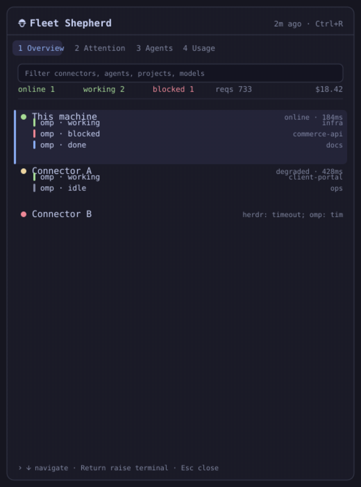
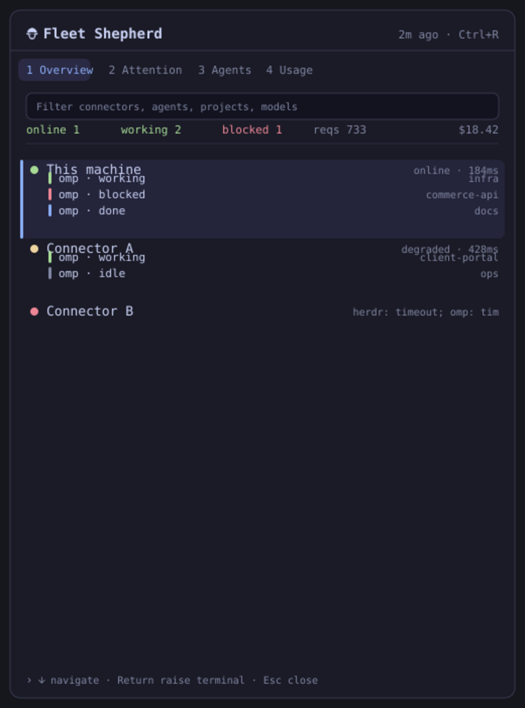

# Fleet Shepherd for Omarchy

[](https://github.com/sponsors/joshuaswarren)



The preview uses sample data, not a live fleet screenshot.

One read-only operations panel for Herdr agents and OMP usage across a local and SSH connector fleet.

Fleet Shepherd answers three questions from the bar: are all connectors healthy, does any agent need attention, and what is the fleet’s aggregate OMP usage?




> Status: v0.1.2 local beta. Read-only fleet snapshots are implemented and live-tested; remote mutation is intentionally not implemented.

## Features

- Local connector plus optional SSH connectors
- Herdr working/blocked/done/idle agent state by connector
- Workspace, project, cwd, and current activity
- OMP requests, cost, tokens, cache/error summaries and top models
- Partial-failure and stale/offline states without discarding the last valid snapshot
- Shared locked runtime cache keeps bar and panel on the same exact snapshot
- Live cross-fleet filter and keyboard navigation
- Strict byte/item/string/concurrency/time bounds
- No network listener, database, raw-session scraping, credentials, or elevated service

## Architecture

The QML plugin starts one bundled Python helper. It calls `herdr api snapshot` and `omp stats --json`, locally or through fixed SSH arguments. See [DESIGN.md](docs/DESIGN.md) and [REQUIREMENTS.md](docs/REQUIREMENTS.md).

```text
Omarchy panel → fleet-snapshot helper → local / SSH connectors
                                   ↘ bounded normalized JSON
```

## Requirements

- Omarchy Quattro / Quickshell
- Python 3.11+ (stdlib only)
- Herdr and/or OMP on each participating connector
- For remote connectors: noninteractive SSH aliases with verified host keys

The plugin does not install, configure, authenticate, or manage Herdr, OMP, SSH, or Tailscale.

## Configuration

Copy the example and edit connector aliases:

```bash
mkdir -p ~/.config/fleet-shepherd
cp connectors.example.json ~/.config/fleet-shepherd/connectors.json
chmod 600 ~/.config/fleet-shepherd/connectors.json
```

```json
{
  "schemaVersion": 1,
  "connectors": [
    { "id": "local", "label": "This machine", "mode": "local" },
    { "id": "connector-a", "label": "Connector A", "mode": "ssh", "target": "connector-a" }
  ]
}
```

`target` is an OpenSSH Host alias from `~/.ssh/config`. Set username, port, identity, proxy and host-key policy in OpenSSH, not this JSON. Unknown or changed host keys are refused.

## Keyboard

- Start typing: filter connectors, agents, projects and models
- `Up` / `Down`: move connector selection
- `Return` / `Enter`: raise the terminal running the selected connector's Herdr
- `1` through `4`: Overview / Attention / Agents / Usage
- `Ctrl+R`: refresh
- `Esc`: clear filter, then close

## Troubleshooting

- First open takes time: an empty cache needs a fleet sweep, which can take up to 60 seconds.
- `no local herdr window`: open a terminal on this machine running `herdr` for local use or `herdr --remote <target>` for that connector. Raising a window does not run SSH.
- Remote command fails: check that `ssh <host> herdr api snapshot` returns JSON without a password prompt.
- OMP shows zero: check that `ssh <host> "omp stats --json"` exits successfully. Usage needs OMP history on that connector.
- Panel missing after reinstall: restart `omarchy-shell` and confirm `enabled=true` with `omarchy plugin list`.
- Config changed but data is stale: the next poll invalidates the config-keyed cache.

## Install

Install directly:

```bash
omarchy plugin add https://github.com/joshuaswarren/omarchy-fleet-shepherd.git --enable
```

## Remove

```bash
omarchy plugin remove io.github.joshuaswarren.fleet-shepherd
```

Optional config cleanup:

```bash
rm -rf ~/.config/fleet-shepherd
```

## Privacy and security

Project paths and terminal titles can be sensitive; the panel shows them locally. Snapshots use a short-lived runtime cache, not a long-term history. The plugin sends no telemetry and reads no raw OMP sessions. Config reads are bounded and refuse symlinks. SSH uses BatchMode and StrictHostKeyChecking=yes; commands and responses have time and size limits.

## Development

Tests:

```bash
python3 -m unittest discover -s tests   # helper, focus, stream isolation, doc claims
node --test tests/                      # Model.js + QML contract tests
```

Preview assets are generated, never screenshotted:

```bash
python3 scripts/make_preview.py         # writes preview.png + preview.gif from tests/fixtures/fleet_demo.json
```

```bash
python3 -m unittest discover -s tests -v
node --test tests/*.test.mjs
qmllint -I /usr/share/omarchy/shell BarWidget.qml Panel.qml
omarchy plugin validate .
```

## Support

[Sponsor on GitHub](https://github.com/sponsors/joshuaswarren) or use Lightning at `joshuaswarren@strike.me`.

## License

MIT. See [LICENSE](LICENSE).